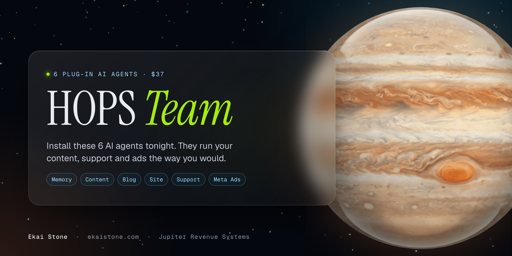

<h1 align="center">The HOPS Team</h1>

<b>Six plug-in AI agents. Each one takes a job off your plate.</b>

  
  
  

---

Install these 6 AI agents tonight and they'll run your content, support and ads the way you would, so you hit $10K a month hands-off, without hiring a team.

Paste one line into Claude. Your HOPS Team learns your offers and your voice, then runs your content, blog, site, support and ads. The same agents behind my $80K and $90K months.

### Meet your HOPS Team

| Agent | Role | What it does |
|---|---|---|
| **01 · One Memory For Every Agent** | Memory Keeper | Your agents remember your offers, your voice and your rules. One memory across every tool and device. No extra subscription. |
| **02 · Content That Makes Itself** | Content Producer | Drop your photos and videos in a folder. Get reels, posts and carousels in your brand. Includes my carousel framework. |
| **03 · Blog Posts That Bring Buyers** | Blog Writer | My long-form framework. The posts that brought in about $40K in my last couple of months. |
| **04 · Your Site, Built By Claude** | Site Builder | Build a site like mine with Claude and Framer. My design system, ready to use. |
| **05 · Support That Runs Itself** | Support Lead | Questions answered in minutes. Every fix updates your site, so the same question doesn't come back. |
| **06 · Claude Runs Your Meta Ads** | Media Buyer | Connect Claude to your ad account the right way, so it can build and report on your ads. |
| **Bonus · Your Hands-Off Profit Map** | | Your delivery mapped, with every place AI can take over ranked by the hours it gives back, plus one quick win and the exact prompt to switch it on this week. |

<b>What's inside each agent</b>

- **01 Memory Keeper:** a house rules file every chat reads first, a memory index with four starter fact files, a setup script that links each computer to one synced folder, a memory checker and a "read this first" note so Codex, Cursor and Gemini CLI use the same memory.
- **02 Content Producer:** an inbox drop folder, 5 design styles (Night Glass, Morning Glass, Sunday Editorial, Clean Slate, Real Talk), the 7-card carousel framework, a reel kit and 7 Claude skills.
- **03 Blog Writer:** the full blog framework, a 5 minute brief, a post template, a pre-publish checklist, schema templates and an SEO and AI search Claude skill.
- **04 Site Builder:** my design tokens in one Framer code file, the design standard, the five-layer build method, build prompts and a render check at three widths.
- **05 Support Lead:** 13 n8n workflows (intake, triage and resolve, fix loop, watchdog, health check, weekly digests), a setup map and a knowledge base builder.
- **06 Media Buyer:** a click by click connection guide, a Claude skill and a read-only account check for your pixel, Page, Instagram and campaigns.

### Add to your order

| Add-on | Price | What it is |
|---|---|---|
| **The Feedback Loop Skill** | $37 | The code and Claude skill behind my agent feedback loop. Plan, do, check, fix and score, in any part of your business. |
| **IG Sales Agent · Starter** | $27 | Your Instagram DMs turned into booked calls. Setup guide + agent persona builder. |
| **Senior Media Buyer Brains** | $49 | The rules my media buyer agent runs on. Cut losers, scale winners, test new angles, morning report. |
| **Full HOPS Team** | $77 | All three above. Save $36. |

### What you need

A Claude account (a paid plan) and a computer. A Mac mini is optional. No coding: you copy one line into Claude and answer its questions. Use it in your business and for your clients. You can't resell the kits.

> **Private repository.** The agents are delivered to your Jupiter Portal in minutes after checkout. [Get your HOPS Team for $37](https://ekaistone.com/hops). Learn it in an evening. Install it the same night.

---

Built by <a href="https://github.com/ekaionjupiter">Ekai Stone</a> · <a href="https://ekaistone.com">ekaistone.com</a> · Jupiter Revenue Systems

